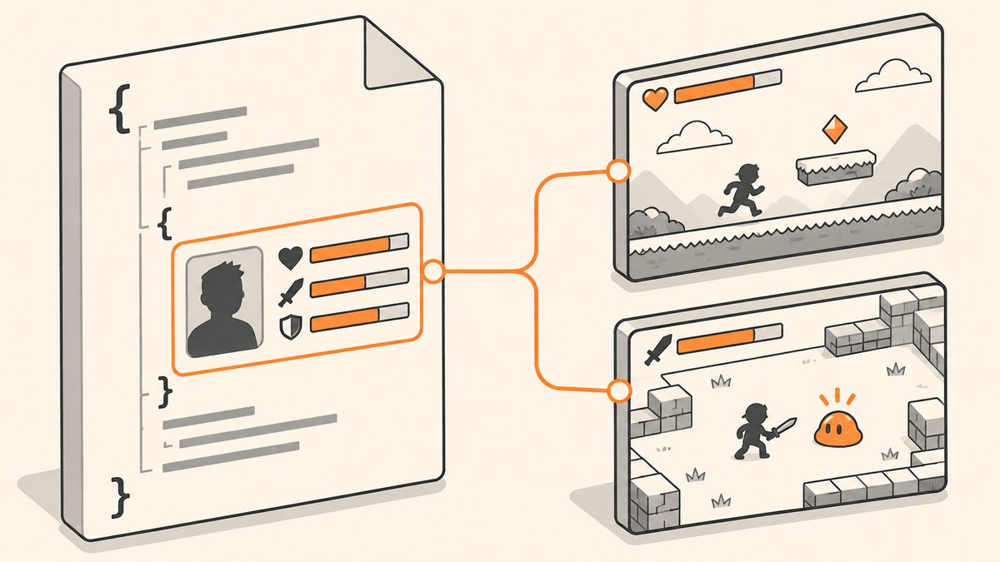

<p align="center"></p>

# Unity Mock Player Data

A single `db.json` file that serves a mock player profile as a REST endpoint for the Unity GET and POST demos.

## What it does

[My JSON Server](https://my-json-server.typicode.com/) turns a `db.json` in a public GitHub repo into a read-only fake REST API. This repo holds one resource, `UnityData`, which the Unity demos read with a GET request and send a `Health` update to with a POST request.

Used by:

- [unity-json-get-post](https://github.com/MemeGamer/unity-json-get-post): loads the profile into UI text and downloads the image.
- [unity-fps-json-sync](https://github.com/MemeGamer/unity-fps-json-sync): loads the profile into a HUD and POSTs when the player picks up a sphere.

## How it works

`db.json` contains one object:

```json
{
  "UnityData": {
    "Name": "Player1",
    "Health": "100",
    "Personality": "2",
    "Charm": "2",
    "Behavior": "2",
    "managment": "3",
    "ImageURL": "https://drive.google.com/uc?export=download&id=..."
  }
}
```

The keys match the `Data` struct in the Unity scripts, so `JsonUtility.FromJson<Data>` can parse the response directly. All values are strings. `ImageURL` points to a Google Drive direct download link for the profile picture.

## Tech

- JSON, served by My JSON Server (typicode).

## Use it

- Endpoint: `https://my-json-server.typicode.com/MemeGamer/unity-mock-player-data/UnityData`
- To make your own: fork or copy this repo, edit `db.json`, and use `https://my-json-server.typicode.com/<your-user>/<your-repo>/UnityData` as the URL in the Unity scripts.
- Keep the key names (including the `managment` spelling) or update the `Data` struct in the Unity scripts to match.

## Scripts

| File | Purpose |
| --- | --- |
| `db.json` | The mock `UnityData` player profile |

## Notes

- My JSON Server is read-only: POST, PUT and DELETE return a response but do not change `db.json`.
- The Unity scripts still point to the old repo name `MockData`. At the time of writing, My JSON Server returned errors for both the old and new URLs, so check that the service is up before relying on it.
